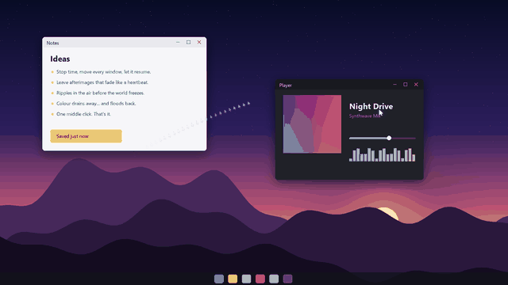
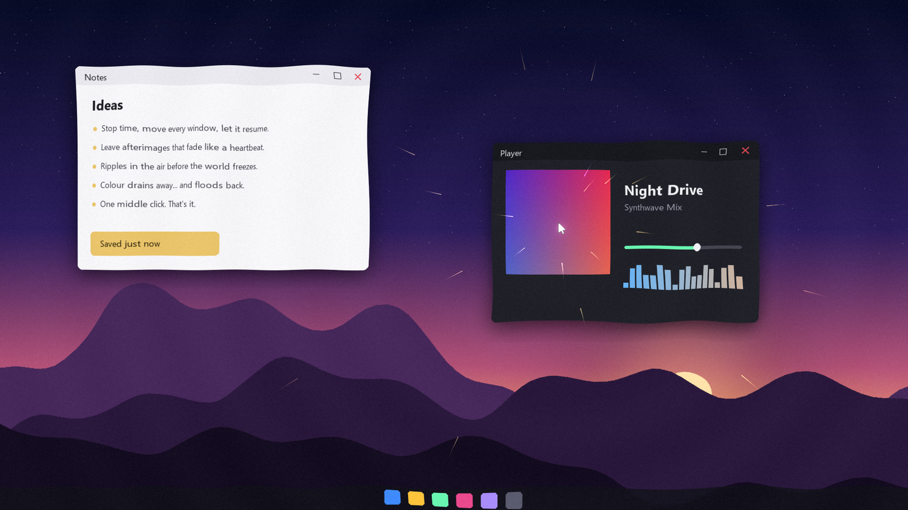
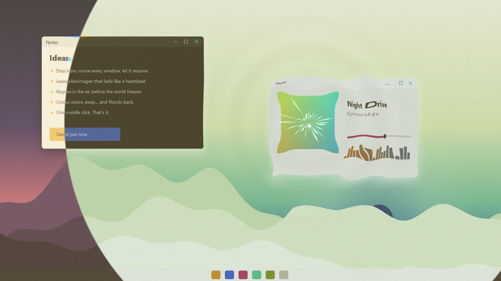
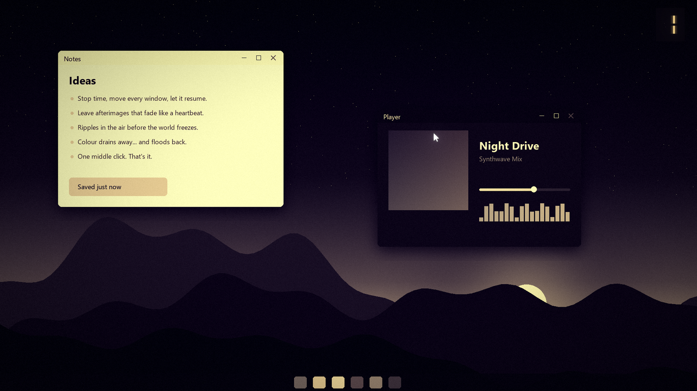
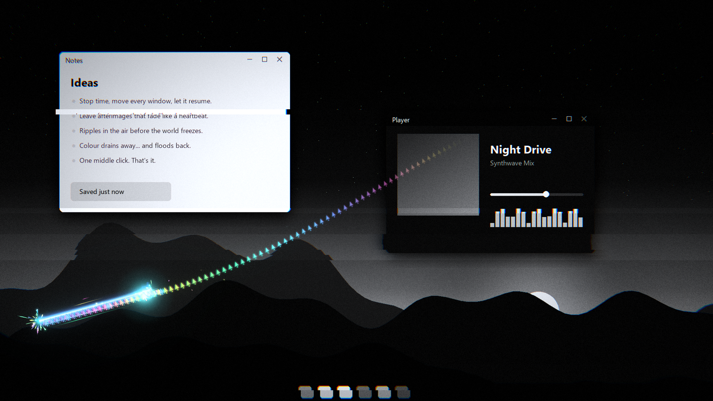
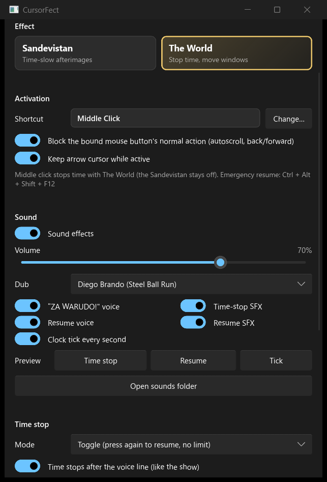

<div align="center">

# Cursorfect

**Anime-grade effects for your real Windows cursor.**
Stop time like DIO. Leave afterimages like David Martinez. Accelerate time with Made in Heaven.

[](https://github.com/virusdeflect21/Cursorfect/releases/latest)
[](https://github.com/virusdeflect21/Cursorfect/releases)
[](LICENSE)


 

**[⬇ Download the latest release](https://github.com/virusdeflect21/Cursorfect/releases/latest)**: a single portable `.exe`. No installer, no admin rights.

</div>

---

## Effects

### ⏱ The World: time stop
Middle click and **time stops on your actual desktop**.

- **The wind-up:** while the voice line plays ("ZA WARUDO!"), golden energy streaks are drawn into your cursor, pressure waves ripple inward, the frozen grade creeps in from the screen edges, and the screen pinches inward with an anamorphic lens flare.
- **The stop:** on the sound's impact, a colour-inverting sphere bursts across the screen and collapses back, air ripples spread, and the world freezes in gold and violet.
- **Move windows in stopped time:** grab any window and drag it. Only its frozen image moves; the real window stays put. When time resumes, every window you moved **jumps to its new place at once**. Esc cancels a drag, Backspace undoes the last move.
- **DIO counts the seconds:** a counter shows how long time has been stopped, with a clock tick every second.
- **Resume:** "Toki wa ugoki dasu", then a white-gold pulse as colour and motion flood back from your cursor.
- **6 voice options:** DIO (JP), Jotaro / Star Platinum (JP), Jotaro (English dub), Diego Brando, DIO Over Heaven, or SFX only.
- **Modes:** Hold, Toggle (no time limit) or Timed (1–9 s).

### ⚡ Sandevistan
- The desktop **drains to black & white** in a wave from your cursor (live, with film grade, lens warp and chromatic fringing). Your real cursor stays in colour.
- Your cursor leaves **frozen, rainbow-cycling afterimages**. The faster you move, the more frames it leaves (up to one every 6 ms).
- **Warp dash** (Ctrl + middle click): teleport the cursor along your movement, with a light streak and speed lines.
- Digital glitch, light rays, sparks and air ripples on activation. Speed bursts when you flick fast.
- **Sound that follows you:** one Sandevistan sound file is cut into a start hit, a **movement loop that swells with your speed**, dash cracks and a power-down.

### ✨ Made in Heaven (MIH)

- **Progressive acceleration, not an instant burst:** starts at **1×**, smoothly reaches **4× over 20 seconds** by default, and returns to normal after a **1.5-second Universe Reset**. The maximum (1–6×), ramp (5–120 s), deceleration (0.2–5 s), and reset duration are configurable.
- **Three visual phases:** calm Awakening → Time Acceleration → Heaven Ascended. Thin cyan trails grow into curved white-core ribbons, 3/7/12 white/cyan afterimages, directional speed particles and a soft heaven aura. Particles, streaks and pressure pulses animate faster as time accelerates.
- **Universe Reset:** a huge expanding white/cyan shockwave, an optional short translucent flash, rapidly dissolving trails, and a smooth return to **1×**. It does **not** restart Windows, move windows, change system time or close anything.
- **Hold / Toggle / Timed**, with an independent configurable shortcut. Default: **Toggle, Middle Click**. Repeat-after-reset is optional and **off by default**; manual cancellation never repeats. Timed mode limits the whole activation, including any repeated cycles.
- **Real pointer acceleration is optional.** It multiplies Windows' already-processed desktop-pointer movement using bounded, injected-event-filtered input, not a driver or game raw-input accelerator. Your Windows sensitivity settings are never changed. If insertion is blocked (e.g. an elevated app / secure desktop), that component fails open while the visuals continue. Large packets are deliberately limited for usability.
- **Compact, hideable white/cyan indicator**, in the same click-through GPU overlay. Existing effects remain mutually exclusive; the Sandevistan warp dash cannot run against MIH.
- **Your existing MP3s:** [`MIHassets`](MIHassets/README.md) maps `made-in-heaven-summon-start.mp3` to activation, `time-accelerate.mp3` to the 35% phase transition, and `universe-reset.mp3` to reset. Missing maximum/deactivation recordings stay silent—no substituted sounds. Uses the existing asynchronous rodio engine and master volume, with an additional relative MIH volume and test buttons.

**Use it:** select **Made in Heaven** in the existing effect picker, keep **Enable Made in Heaven** on, choose a shortcut/mode, switch the master **On**, and activate. Turning it off normally decelerates over 1.5 seconds. **Ctrl + Alt + Shift + F12**, master off, changing effects, recording/changing the shortcut, and exit disable the pointer modifier immediately. A 300 ms renewable input lease also prevents a stalled engine from continuing acceleration.

To use only the visuals, uncheck **Enable real cursor acceleration**. Afterimages, trails/streaks, particles, aura, reset flash, indicator, intensity and MIH SFX can all be changed independently without altering the Sandevistan/The World configuration.

### 🎨 Rendering
Direct3D 11 + DirectComposition overlay with a full **HDR pipeline**: 16-bit float target, 6-level physically wide bloom, soft-shoulder tonemapping with white-hot highlights, and dithering (no banding). Synced to your monitor's refresh rate (60–360 Hz).

<table>
<tr>
<td></td>
<td></td>
</tr>
<tr>
<td></td>
<td></td>
</tr>
</table>

## Settings



Everything can be switched on and off separately:

- **Every sound:** voice line, time-stop SFX, resume voice, resume SFX, clock ticks; Sandevistan start / movement / dash / end.
- **Every visual:** ripples, inversion, tint, flash, energy streaks, lens flare, light rays, counter, glitch, afterimages, trails, sparks, bloom…
- Colour presets (David, Smasher, Ghost or custom), intensity, afterimage length, dash distance.
- Any key, key combo, middle click or side mouse button as the shortcut.
- Performance mode, frame-rate cap, start with Windows, tray icon.

<br clear="right"/>

## Install

1. Download `CursorFect-vX.Y.Z-windows-x64.zip` from **[Releases](https://github.com/virusdeflect21/Cursorfect/releases/latest)** and unzip it anywhere.
2. **Add your sound files** to the `sounds` folder ([what goes where](assets/sounds/README.md)). Sounds are not included because they're copyrighted. Without them the Sandevistan uses built-in synthesized sounds and The World runs silently.
3. Run `cursorfect.exe`, pick an effect, flip the switch at the top to **On**.

> Windows SmartScreen may warn about an unrecognized app because the exe isn't code-signed. Click *More info → Run anyway*, or build it yourself (below).

## Controls

| Action | Default |
|---|---|
| Activate the selected effect / stop & resume time | **Middle click** |
| Warp dash (Sandevistan) | **Ctrl + Middle click** |
| Drag a window while time is stopped | **Left mouse button** |
| Cancel the current drag / undo the last move | **Esc** / **Backspace** |
| Emergency off (always works) | **Ctrl + Alt + Shift + F12** |

Starting `cursorfect.exe` while it's already running brings the existing settings window forward. Closing the window or choosing *Hide to tray* keeps it running when the tray is available; choose **Exit** from the tray menu to quit cleanly.

## Safety & privacy

- **Nothing leaves your PC:** no network access, no telemetry, no accounts.
- **No admin rights, no injection, no drivers.** Windows are moved with the normal `SetWindowPos` API, only when time resumes. Elevated, maximized and system windows are skipped.
- Clicks are only swallowed while time is stopped. Toggle and Hold stop by themselves after 5 minutes at most, the emergency shortcut always resumes, and an independent **watchdog thread** gives input back if the app ever stalls.
- The overlay is click-through and hidden from screen capture (it never records itself). Recorders and screenshots therefore won't show the effects.

## Build from source

Requires Rust (MSVC toolchain) and Visual Studio Build Tools ("Desktop development with C++").

```powershell
git clone https://github.com/virusdeflect21/Cursorfect
cd Cursorfect
cargo build --release        # -> target\release\cursorfect.exe
cargo test                   # unit tests
cargo fmt
cargo clippy --all-targets
.\build.ps1                  # release tests + build, copies existing MIHassets beside exe
```

Developer tools: `cursorfect.exe --render-test-tw <dir> [--measure] [--demo-desktop <bg.bmp>]` renders a full time stop (optionally on a synthetic desktop when live capture is unavailable), `--render-test <dir>` does the Sandevistan, `--render-test-mih <dir> [--measure]` checks the MIH GPU cycle without modifying the real cursor or playing audio, `--ui-self-test <dir>` checks the native settings controls/tray and saves an application-only UI image without touching user settings, and `--demo-shots <bg.bmp> <bg_moved.bmp> <dir>` produces the README material on a generated demo desktop.

<details>
<summary><b>How it works</b></summary>

- **Overlay:** a topmost, click-through, no-activate window presenting a premultiplied-alpha DXGI swap chain through DirectComposition, excluded from capture with `WDA_EXCLUDEFROMCAPTURE`.
- **World pass:** DXGI Desktop Duplication streams every monitor into GPU textures; a pixel shader regrades them (black & white / frozen gold-violet), adds refraction ripples, the inversion sphere, glitch slices and chromatic aberration. The World stops pulling new frames, and that's the freeze.
- **Effects:** CPU-simulated geometry (ribbons, discs, rings, cursor sprites with a dilated-alpha neon halo) rendered into an RGBA16F target, then bloom (13-tap downsample / tent upsample) and a tonemapped composite.
- **Input:** low-level mouse/keyboard hooks on a dedicated thread match shortcuts and forward cursor history. MIH optionally adds bounded screen-space movement math and filtered absolute input packets, with non-blocking locks, immediate emergency cancellation and a renewable safety lease.
- **Audio:** rodio; sound files are decoded once and cut into parts with equal-power fades, seamless cross-faded loops and loudness normalization.
- **Pacing:** each frame waits for the next DWM composition, so every refresh gets exactly one frame.
</details>

## License & credits

CursorFect is released under the **[MIT License](LICENSE)**.

<a href="https://slint.dev"></a>

The settings UI is built with [Slint](https://slint.dev), used under the [Slint Royalty-free Desktop License 2.0](https://github.com/slint-ui/slint/blob/master/LICENSES/LicenseRef-Slint-Royalty-free-2.0.md). Other dependencies (windows-rs, rodio, tray-icon, serde, glam, tracing, …) are MIT / Apache-2.0.

**Disclaimer:** CursorFect is an unofficial fan project, not affiliated with or endorsed by CD PROJEKT RED / Studio Trigger (*Cyberpunk: Edgerunners*) or Hirohiko Araki / Shueisha / David Production (*JoJo's Bizarre Adventure*). All names belong to their owners. No copyrighted audio or artwork is distributed with this project.
